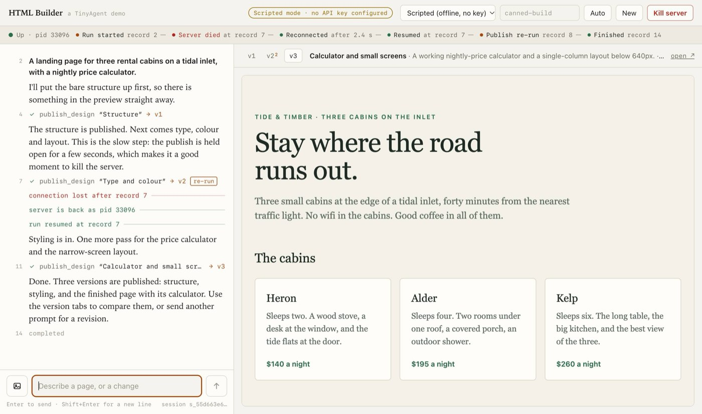

# HTML Builder: a durable artifact builder

Describe a page, watch it get built, kill the server in the middle, and it
picks up where it stopped.

A two-pane web app on the TinyAgent TypeScript SDK. Chat is on the left. On the
right is a live preview of the page the agent is building. The agent has one
tool, `publish_design`, which saves a complete HTML document as a new numbered
version. Follow-up prompts publish further versions, and you can flip between
them.



It is about 1,500 lines in five files, with no framework, no bundler and no
dependency beyond the SDK:

| File | What it holds |
| --- | --- |
| `server.ts` | The process: the SDK's `serve()`, the page, the demo routes, the supervisor |
| `designs.ts` | The `publish_design` tool and the version files |
| `scripted.ts` | The offline model: a canned build for when there is no API key |
| `index.html` | The whole interface: inline CSS and plain JavaScript |
| `kill_resume.test.ts` | The crash-and-resume claim as an offline test |

## Run it

Node.js 22.18 or later. The demo imports the SDK straight from this
repository, so install the SDK's one dependency first:

```sh
cd tinyagents/typescript && npm ci --ignore-scripts
cd ../../examples/html-builder
node server.ts --allow-kill
```

Open <http://127.0.0.1:4380>. With no API key in the environment this is
**scripted mode**: an offline stand-in for the model plays the same three-step
build for any prompt, and the page says so. Nothing leaves your machine.

With a model:

```sh
OPENAI_API_KEY=...    node server.ts --allow-kill
ANTHROPIC_API_KEY=... node server.ts --allow-kill
TINYAGENT_BASE_URL=http://localhost:11434/v1 TINYAGENT_MODEL=qwen3 node server.ts   # any OpenAI-compatible server
```

Every provider that has a key appears in the picker at the top, next to a
model name you can edit. Keys stay in the server process. The page is only
told which providers exist. When `TINYAGENT_BASE_URL` is set,
`OPENAI_API_KEY` is treated as that server's key and is not sent to OpenAI.

| Option | Meaning |
| --- | --- |
| `--allow-kill` | Turn on the **Kill server** button and run under the supervisor. Off by default |
| `--scripted` | Offer scripted mode only, even if keys are set |
| `--port <n>`, `PORT` | Port. Default 4380 |
| `--data <dir>` | Where sessions and versions are kept. Default `data/` here, which git ignores |
| `TINYAGENT_PROVIDER`, `TINYAGENT_MODEL` | The model name offered first for that provider |
| `HTML_BUILDER_SLOW_MS` | How long scripted mode holds its slow publish open. Default 8000 |

## Kill and resume in thirty seconds

1. `node server.ts --allow-kill`, open the page, click the first example and
   press Enter.
2. Version 1 appears. The second publish is the slow step: its line in the
   chat spins for eight seconds.
3. Press **Kill server** while it spins. The server process calls
   `process.exit(1)` on the spot. The strip under the header turns red:
   *Server died at record 7*.
4. Two seconds later the supervisor has started a new process. The page
   reconnects, opens the session again from its journal, resumes the run and
   keeps streaming: *Reconnected → Resumed at record 7 → Publish re-run →
   Finished*.
5. There are three versions, not four. The `v2` tab carries a small ² and the
   note "written 2×, stored once": the publish ran before the crash and again
   after it, and both runs wrote the same file.

Reload the page in the middle of a run and it carries on too: the run belongs
to the server, and the page replays the journal and joins the live stream.

Without `--allow-kill` nothing restarts the server for you, and the page does
the same when you do it by hand: stop the server with Ctrl+C or `kill -9`
during a run, start it again, and the open page reconnects and resumes. The
numbers in the chat's left margin are journal record numbers.

In scripted mode the kill usually lands inside the slow publish. With a real
model it more often lands while the model is writing. Then no tool was in
flight, and resume asks the model for that turn again.

## How it works

Each durability feature is a few lines.

**The journal.** The server hands the SDK a directory and nothing else
(`server.ts`):

```ts
const api = await serve(agent, { host: "127.0.0.1", port: 0, token, directory: sessionsDir, allowedOrigins: origins });
```

Every session is one append-only file under `data/sessions/`.

**A tool that is safe to run twice.** A tool call is journaled before the
handler runs and again when it returns. If the process dies in between, the
journal cannot know whether the file was written. `idempotent: true` tells
`resume()` it may find out by running the call again, and the handler is given
the same `executionId` both times. The file name comes from it (`designs.ts`):

```ts
idempotent: true,
handler: async ({ title, summary, html }, signal, { executionId }) => {
  const [sessionId, sequence] = executionId.split(":");
  const file = join(directory, sessionId, `${sequence}.json`);
  const earlier = read(file);
  const version = earlier?.version ?? listVersions(directory, sessionId).length + 1;
```

A rerun finds the file its first attempt left, keeps that version number and
overwrites it. A handler that counted the versions and wrote the next one
would have published the same design twice.

**Runs that outlive their connection.** The page starts every run detached
and drops the response (`index.html`, `send`):

```js
let reply = await post(`/sessions/${state.sid}/prompts`, { ...state.pending.send, detach: true });
reply.body?.cancel();
follow();
```

**Follow from a cursor.** Whatever is on screen came from one endpoint
(`index.html`, `follow`):

```js
const reply = await fetch(`/sessions/${state.sid}/events?after=${state.cursor}&follow=1`);
for await (const event of lines(reply)) show(event);
```

It replays what the journal holds after record `cursor`, then streams the
active run until it ends. Events with a journal record behind them carry that
record's number as `cursor`. The page keeps the highest it has shown and
ignores anything at or below it (`show`), so reconnecting never shows a line
twice. Text of a model turn that is still streaming has no record yet. It is
dropped on reconnect, because the stream sends it again.

**Reopen and resume.** When a stream ends and the run on screen has not, the
page waits for the server, opens the session and looks at one field
(`index.html`, `server` and `recover`, in outline):

```js
await post("/sessions", { sessionId: state.sid });                      // open it from its journal
const info = await (await fetch(`/sessions/${state.sid}?limit=1`)).json();
if (info.resumable) await post(`/sessions/${state.sid}/resume`, { detach: true });
follow();
```

The SDK's server never resumes a run by itself at startup. A client asks.

**Sending a prompt once.** Each prompt carries a `messageId`. If the server
dies before the page learns whether the prompt arrived, the page sends it
again with the same ID, and the SDK resumes that run or starts it, never both.

**The offline model.** `scripted.ts` wraps the SDK's `ScriptedProvider`. It
keeps no position. Which turn to play is read from the history sent with each
request, so a restarted server answers a resumed run where the dead one
stopped.

### The test

```sh
node --test kill_resume.test.ts        # about two seconds, no key, no network
```

It starts the server as a child process on a random port with a temporary
data directory, starts a detached run, waits until the second publish has
written its file and not yet returned, and sends `SIGKILL`. It then starts a
second server on the same data, reopens the session, resumes, and follows from
the last cursor it saw. It asserts that the run completes, that the cursors
seen across both servers only go up, that the interrupted publish was rerun
with the same `executionId`, and that there are exactly three versions with
write counts 1, 2 and 1.

## Safety

The generated HTML is model output and is treated as untrusted.

- **The preview is sandboxed twice.** The `<iframe>` has
  `sandbox="allow-scripts"` without `allow-same-origin`, so the design runs
  its scripts in an origin of its own and cannot read the app, its storage or
  its DOM. The design is also served with
  `Content-Security-Policy: sandbox allow-scripts; default-src 'none'; ...`,
  so the same holds when a version is opened directly in a tab, and the
  design cannot fetch, post, or load an image, font or script from anywhere,
  the agent API included. A design that needs an external resource will show
  without it. The agent is told to keep everything inline.
- **The agent API accepts one origin.** The SDK refuses any request whose
  `Origin` is not on its list. The list holds this page's own origin
  (`http://127.0.0.1:<port>` and `http://localhost:<port>`) and nothing else.
  The sandboxed preview's origin is `null`, which is refused. The demo's own
  routes, the kill switch among them, apply the same Host and Origin checks.
- **One loopback port.** The server binds `127.0.0.1` only. The SDK's server
  listens on a second, random loopback port behind a random bearer token that
  only this process knows; the public port forwards to it with `Host` and
  `Origin` unchanged, so the SDK's checks still decide.
- **The app shell** is served with a CSP that allows only its own nonced
  script and style, connections to itself, and frames from itself, plus
  `Referrer-Policy: no-referrer`, `X-Content-Type-Options: nosniff` and
  `frame-ancestors 'none'`. It loads nothing from the network: no fonts, no
  CDN.
- **API keys** are read from the server's environment and never sent to the
  page.
- **The kill switch** is off unless you pass `--allow-kill`.

This is a demo for one person on one machine. There are no accounts, and
anyone who can reach the port can use the model key behind it. Do not expose
it to a network.

## Limits

- The preview updates when a version is published. The SDK streams the
  model's text, not its tool arguments, so the HTML does not appear character
  by character.
- An attached reference image (the picture button, or paste) is scaled down
  in the page to fit the SDK's one-megabyte request limit. Scripted mode
  ignores it.
- The provider and model are one setting for the whole server, kept in
  `data/settings.json`, not per session.
- Scripted mode ignores what the prompt says: three versions of one page for
  the first prompt, a recoloured version for each later one.
